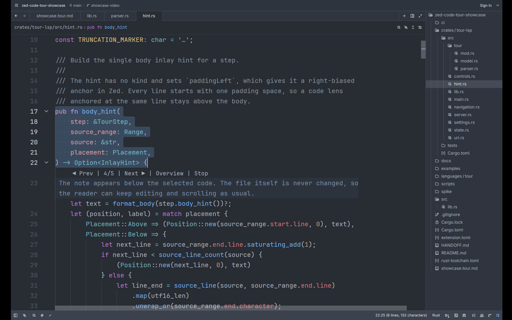

# Showcase

A 30 second walkthrough of using a code tour in Zed. A new contributor opens
[showcase.tour.md](../showcase.tour.md), presses Start tour, and follows the
notes through the codebase. Each stop lands on the exact lines, the note appears
beside the code, and Previous / Next / Overview / Stop stay within reach.

The clip has no audio. Click the poster, or open
[media/zed-code-tour-showcase.mp4](media/zed-code-tour-showcase.mp4) directly.

The source file is never edited. Stop the tour and the overlays disappear. A
tour is just Markdown, so it is easy to write for onboarding, code review, or a
deep dive, then share the file with the next reader.

The recording was made in a real Zed 1.26.2 window under Xvfb. The capture and
render scripts live in [scripts/showcase](../scripts/showcase/README.md).
